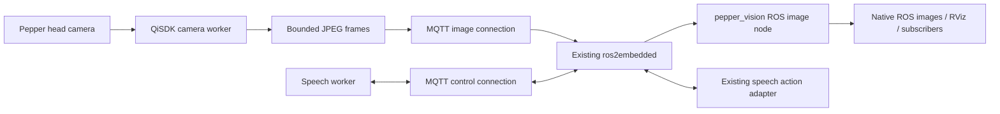

# pepper_vision

Pepper head-camera images and the lab-verified speech implementation in a **separate Android app**, using MQTT and the existing `ros2embedded` bridge. Camera images are native ROS messages, ready for subscribers, RViz, recording and image processing.

The `say_pepper`, `Hello-Pepper` and `ros2embedded` source trees are preserved. The new ROS package reuses the existing `say_pepper_interfaces` action and `say_pepper_bridge` speech adapter without changing them.

## What is implemented

- Speech through `/pepper/say`, including feedback, cancellation, local stop, focus checks and the background-worker threading fix from `say_pepper` 0.1.2.
- Repeated QiSDK `TakePicture` capture from **Pepper's head camera**, not the tablet selfie camera.
- JPEG over MQTT, native `sensor_msgs/msg/CompressedImage` through unchanged bridge discovery, plus ROS-side decoded `sensor_msgs/msg/Image` in `rgb8`.
- A live tablet preview, independent speech/camera switches, editable broker IP, MQTT 1883 / TLS 8883 and optional credentials. The last broker address is remembered; passwords are not stored.
- A separate camera worker and MQTT image connection so large image traffic does not share the speech/control socket. One capture, one outgoing image, and one pending latest frame at most; stale pending frames are replaced. Images use QoS 0 without retention or offline buffering. Control and speech keep QoS 1.
- Automatic stop on pause, focus loss, bridge-lease expiry or image-connection loss, with explicit re-enablement required. Camera failures include the SDK stage/error in the UI and `PepperVision` logcat tag.
- Native `CameraInfo`, optional real calibration, diagnostics, an RViz preset, and an FPS/latency probe.

**Depth:** the public QiSDK 1.7.5 `Camera` API exposes `TakePicture`, but no raw depth-map stream. This app reports `depth_available=false`; it does not publish fake depth, a point cloud, or a synthetic RGB-D pair. This is a limitation of this SDK path, not a claim that Pepper has no depth hardware. Adding a real depth backend later requires a supported depth source and its calibration/extrinsics. The current robot-password-free tablet route supplies RGB.



## ROS interfaces

| Interface | ROS type | Details |
|---|---|---|
| `/pepper/say` | `say_pepper_interfaces/action/Say` | Existing speech goal/client, unchanged |
| `/pepper/camera/color/image_raw/compressed` | `sensor_msgs/msg/CompressedImage` | JPEG, depth-one reliable publisher |
| `/pepper/camera/color/image_raw` | `sensor_msgs/msg/Image` | `rgb8`; decoded when a raw-image subscriber exists |
| `/pepper/camera/color/camera_info` | `sensor_msgs/msg/CameraInfo` | Matching image stamp/frame; K[0]=0 until real calibration is supplied |
| `/pepper/camera/diagnostics` | `diagnostic_msgs/msg/DiagnosticArray` | RGB reception/errors, calibration and depth availability |

Image `frame_id`: `pepper_head_camera_optical_frame`. No fabricated camera-to-base transform is broadcast. The head moves, so a static camera-to-base transform would generally be wrong. RViz's **Image** display can show the image without a robot TF model. Geometric Camera-display overlays require actual calibration and TF.

Internal bridge namespace:

```text
/ros2embedded/domain_7/connection_pepper_5fvision
```

Its native image topic is `camera/color/image_raw/compressed`. The `camera/metadata` String topic contains session, frame sequence, original robot monotonic timestamp, output dimensions and JPEG size. Speech state/events and capabilities remain on the usual relative topics. There is no ROS depth-image topic while depth is unavailable.

## FPS: start at 2, then measure

The default is a **2 FPS target**, JPEG quality 70, fitting within **640 × 480** while preserving aspect ratio. This is a conservative engineering starting point, **not a measured Pepper throughput guarantee**. QiSDK copies each image from the head to the tablet, which can dominate capture time; it is a still-image API, not a documented high-rate video subscription API.

- Start with **2 FPS** for observation, object detection and snapshots.
- Use **1 FPS** or 0.5 FPS if capture or Wi-Fi is slow.
- Try **3 FPS**, then **5 FPS at 320 × 240**, only after checking the received rate, age and speech cancellation. Five FPS is an experimental target, not a promise.
- Changing the output size reduces JPEG processing/transmission cost; it does not change the head camera's native capture resolution through this API.
- The app never overlaps captures or launches catch-up bursts. Achieved FPS can be below the selected target.

Frames are limited to **128 KiB JPEG**, below the bridge's 256 KiB decoded compressed-image limit. Base64 adds about one third to the MQTT image body. At the cap, a 2 FPS stream carries roughly 2.8 Mbit/s of base64 image data before protocol overhead; actual JPEG sizes are reported in metadata. MQTT is lightweight, but JPEG acquisition and image transfer still determine useful FPS.

Measure at the ROS receiver:

```bash
ros2 run pepper_vision_bridge vision_probe --duration 30
```

The report includes received FPS, frame count, JPEG size and approximate p50/p95 frame age. Use it while RViz is open and speech is running. Choose the highest setting that stays stable for several minutes with fresh images and responsive cancellation. A low age and no accumulating delay matter more than the requested FPS number.

## 1. Build or transfer the APK

The locally built APK is `artifacts/pepper_vision-debug.apk`. Copy it to the tablet-connected lab laptop. The source archive `artifacts/pepper_vision-source.zip` includes the new project and the two existing ROS speech packages needed for a standalone transfer; it excludes generated builds and machine-specific paths.

These files are prepared locally. They are not automatically pushed to GitHub, and generated APK/build folders are not tracked by Git. Transfer the source archive before building on a lab checkout that does not yet contain `pepper_vision`.

From `pepper_ros2/pepper_vision/android`, with the same JDK/Android SDK setup that built `say_pepper`:

Windows:

```powershell
.\gradlew.bat assembleDebug
```

Linux/macOS:

```bash
./gradlew assembleDebug
```

The output is `app/build/outputs/apk/debug/app-debug.apk`. The project uses Gradle 7.6.3, AGP 7.3.0, compile SDK 34, min SDK 23 / Android 6, target SDK 28 and QiSDK 1.7.5 / robot API 7. It was built locally with Java 17. The existing Java 11 command-line build setup is also compatible with this Gradle/AGP combination. Old Android Studio project sync is not required for the wrapper build.

## 2. Install on Pepper's tablet

The lab tablet address was `192.168.50.6`; update it if the tablet changes address. The spoken robot IP `192.168.50.75` is not the ADB tablet address.

For the ready-built APK, from its folder:

```bash
adb connect 192.168.50.6:5555
adb -s 192.168.50.6:5555 install -r pepper_vision-debug.apk
adb -s 192.168.50.6:5555 shell am start -n com.rosnect.peppervision/.MainActivity
```

For a local Gradle build, use `app/build/outputs/apk/debug/app-debug.apk` in the install command instead.

Keep **pepper_vision** open. Only one foreground robot app should own QiSDK focus; close the old `say_pepper` app. This is a distinct application ID, so the old app remains installed.

No robot login password is required by this app. The merged APK uses Internet/network-state and QiSDK's robot permission. It accesses the **head camera through Robot Service**, so it does not request Android's tablet-camera, microphone, location or storage runtime permissions. Existing authorized tablet ADB access and a working QiSDK robot-focus environment are required, as with the speech app.

## 3. Build the ROS side on Linux

First stop the previous `say_pepper.launch.py` process. Both apps expose `/pepper/say`; do not run two speech action servers for that same action name.

Source your actual ROS installation and already-working `ros2embedded` overlay. Example for Humble:

```bash
source /opt/ros/humble/setup.bash
source /path/to/ros2embedded/install/setup.bash
cd /path/to/pepper_ros2
```

Install any missing standard ROS/image dependencies. On Ubuntu with Humble:

```bash
sudo apt-get install ros-humble-sensor-msgs ros-humble-diagnostic-msgs \
  python3-opencv python3-numpy python3-yaml ros-humble-rviz2
```

Build only the speech interfaces/adapter and the new vision adapter in a separate output directory:

```bash
colcon --log-base pepper_vision/log build \
  --base-paths say_pepper/ros2 pepper_vision/ros2 \
  --build-base pepper_vision/build --install-base pepper_vision/install \
  --symlink-install --packages-up-to pepper_vision_bridge
source pepper_vision/install/setup.bash
```

This reuses the installed `bridge_manager`; it does not rebuild or modify `ros2embedded`. Keep the ROS terminals on the same DDS `ROS_DOMAIN_ID`. The logical bridge `domain_id=7` controls routing/namespacing and is independent of that environment variable.

Before hardware, optional isolated ROS smoke tests:

```bash
python3 pepper_vision/tests/ros_vision_smoke.py -v
python3 say_pepper/tests/ros_action_smoke.py -v
```

These use fake local topic peers in unique namespaces, and do not connect to a broker or Pepper.

## 4. Run camera and speech

Use the current Wi-Fi IP of the computer running Mosquitto for `BROKER_IP`, on both the tablet and Linux host:

```bash
ros2 launch pepper_vision_bridge pepper_vision.launch.py broker:=BROKER_IP rviz:=true
```

The launch starts an existing bridge-manager instance with **connection_id `pepper_vision`, domain 7**, the existing speech adapter configured for that connection, the new camera adapter, and optionally RViz. The phone can continue on its own connection ID. Do not start a second bridge owner for `pepper_vision`.

On the tablet:

1. Enter the broker address and select **1883 · MQTT** (or your configured TLS broker).
2. Tap **Connect**. Wait for **bridge ready**, **robot focus**, and **image transport connected**.
3. Select **2 FPS** and **640 × 480 maximum** while the camera is off.
4. Turn on **Stream head camera**. The preview and capture/write counters should advance.
5. Turn on **Enable remote speech** when ready to test speech.

In RViz, the supplied preset adds an **Image** display on `/pepper/camera/color/image_raw`. If configuring manually, use Image, raw transport, depth 1, Best Effort, Volatile. The raw topic carries `rgb8` Image data; no extra image-transport republisher is needed. A preview on the tablet or a write counter alone does not prove ROS received/decoded the images—verify RViz or run the probe.

In another terminal with the same overlays sourced:

```bash
ros2 topic type /pepper/camera/color/image_raw
ros2 run say_pepper_bridge pepper_say "Hello. I can speak while my head camera streams to ROS 2."
ros2 run pepper_vision_bridge vision_probe --duration 30
```

Expected image type: `sensor_msgs/msg/Image`. Subscribe directly to the raw or compressed topic in your own ROS node. ROS handles the messages normally; no JSON camera decoder is needed in your subscriber.

## 5. Validate stop/recovery in the lab

- Run speech while streaming; try ROS cancellation (`pepper_say ... --cancel-after 1`) and the tablet's **STOP SPEECH + CAMERA** button.
- Switch away from the app: both features must stop/disable. Returning does not start them automatically.
- Disconnect MQTT / interrupt Wi-Fi: stop and clear pending images, then reconnect and manually enable again.
- Stop the host bridge: the tablet's configuration lease expires after approximately eight seconds and disables features. The camera also stops after three repeated errors or a ten-second capture watchdog; an unconfirmed capture remains busy until the SDK completes it.
- Capture failures show `QiSDK camera build/capture/copy/encode: ...`. Speech failures retain the exact SDK diagnostic. On the tablet-connected laptop:

```bash
adb -s 192.168.50.6:5555 logcat -v time "PepperVision:V" "*:S" > pepper_vision_log.txt
```

## Calibration, timestamps, TLS and depth

ROS image headers use **tablet wall time when the capture result arrives**, before the remote image copy/encoding. QiSDK's original sensor timestamp is a **robot monotonic nanosecond count**, not Unix time, and is preserved separately in frame metadata. It is not falsely cast into ROS epoch time. This header is an approximate acquisition timestamp, not a synchronized exposure timestamp. The probe's age measures from that tablet receipt point; it excludes earlier exposure/head-to-tablet-result delay.

Enable automatic network time on the tablet and synchronize the Linux clock. Frames over three seconds old or more than three seconds in the future are dropped by the vision adapter. Adjust `max_frame_age_sec` if necessary; 0 disables that check. This is not an exposure-synchronized RGB-D sensor.

The default `CameraInfo` deliberately has zero K/R/P and no asserted distortion model, as ROS specifies for an uncalibrated camera. To use real calibration from ROS's camera calibration tooling:

```bash
ros2 launch pepper_vision_bridge pepper_vision.launch.py \
  broker:=BROKER_IP calibration_file:=/absolute/path/to/real_camera.yaml rviz:=true
```

The calibration YAML must match the actual streamed image dimensions. A mismatch is reported and publishes uncalibrated info instead of incorrect intrinsics. No example fabricated calibration is supplied. Use real extrinsics and time alignment before metric perception or projection.

For TLS/credentials, configure both tablet connections from the same editable UI. TLS uses Android's trusted CA store and verifies hostname; custom CA/client-certificate UI is not implemented. If the host bridge needs TLS/credentials, run your existing `bridge_manager` with a local ROS parameter file (`mqtt_tls`, `mqtt_username`, etc.), connection `pepper_vision` and domain 7, then launch this package with `start_bridge:=false broker:=BROKER_IP`. Setting only port 8883 does not enable host TLS. Broker ACLs must allow the control client to publish config/to_ros and subscribe to to_device/config_status/config_request under `ros2embedded/7/pepper_vision/`, and the image client to publish to `to_ros` under the same prefix.

Depth is explicitly unavailable in this implementation. Future genuine depth images should use `sensor_msgs/msg/Image` (`16UC1` millimetres or `32FC1` metres), proper depth `CameraInfo`, and measured RGB-depth extrinsics/time alignment. Do not infer metric depth from the RGB JPEG or relabel it as depth.

See [validation](docs/validation.md) for checks already run and those still requiring Linux/Pepper.

## Primary references

- [QiSDK TakePicture](https://qisdk.softbankrobotics.com/sdk/doc/pepper-sdk/ch4_api/perception/reference/takepicture.html): capture and explicit remote image copy. Public camera methods were also inspected in the actual 1.7.5 dependency JAR.
- [QiSDK timestamps](https://qisdk.softbankrobotics.com/sdk/doc/pepper-sdk/ch4_api/perception/reference/timestamps.html): robot monotonic nanoseconds, separate from tablet time.
- [QiSDK worker-thread requirements](https://qisdk.softbankrobotics.com/sdk/doc/pepper-sdk/ch2_principles/sync_async.html).
- [ROS Image](https://github.com/ros2/common_interfaces/blob/humble/sensor_msgs/msg/Image.msg), [CompressedImage](https://github.com/ros2/common_interfaces/blob/humble/sensor_msgs/msg/CompressedImage.msg), [CameraInfo](https://github.com/ros2/common_interfaces/blob/humble/sensor_msgs/msg/CameraInfo.msg).
- [Existing bridge native sensor contract](../../ros2embedded/docs/native_sensors.md), inspected read-only.
